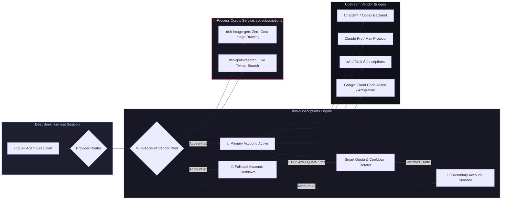

# 📦 @goodandready/dsh-subscriptions

<div align="center">

<h3>Personal AI Subscription Bridge, Multi-Account Pool Rotation & Zero-Leak OAuth for DeepSeek Harness</h3>

<p align="center">
  <a href="https://www.npmjs.com/package/@goodandready/dsh-subscriptions"></a>
  <a href="LICENSE"></a>
  <a href="https://github.com/topics/dsh-plugin"></a>
  <a href="https://nodejs.org"></a>
</p>

<p align="center">
  <a href="https://goodandready.app/"></a>
</p>

<p align="center">
  <a href="README.md"><b>🇬🇧 English</b></a> •
  <a href="README.ru.md"><b>🇷🇺 Русский</b></a> •
  <a href="README.zh.md"><b>🇨🇳 中文说明</b></a>
</p>

</div>

---

## ⚡ Overview

**`dsh-subscriptions`** bridges your paid personal AI subscriptions directly into **DeepSeek Harness** as first-class LLM providers.

Instead of burning expensive pay-as-you-go API credits for everyday agent tasks, `dsh-subscriptions` authenticates your existing web subscriptions through standard OAuth PKCE. It adds **multi-account rotation pools** that switch accounts when a rate limit or cooldown is reached, **preemptive quota switching** before a window runs dry, and an **in-process Cordis service (`ctx.subscriptions`)** that powers sibling plugins such as [`dsh-image-gen`](https://github.com/GooDAnDReaDY/dsh-image-gen) and [`dsh-grok-xsearch`](https://github.com/GooDAnDReaDY/dsh-grok-xsearch) with zero token leakage.



---

## ✨ Capabilities

### 🌐 Supported built-in subscription vendors

| Vendor Key | Subscription Tier | Protocol & Features |
|---|---|---|
| `codex` | ChatGPT Plus / Pro | Codex streaming responses, tool calling & image drawing (`/backend-api/codex/...`) |
| `claude` | Claude Pro / Max | Native Claude Messages protocol, usage tracking (`/v1/messages`, `/api/oauth/...`) |
| `grok` | xAI / X Premium | Real-time reasoning responses, billing checks & social search |
| `antigravity` | Google Cloud Code Assist | Antigravity engine (`/v1/loadCodeAssist`, `/v1/streamGenerateContent`) |
| `kimi` | Moonshot Kimi | OAuth Device Flow login, OpenAI-compatible chat |
| `glm` | Z.ai GLM Coding Plan | GLM coding endpoint, live quota monitor |
| `cursor` | Cursor | Cursor backend, billing-period usage dashboard parsing |
| `kiro` | AWS Kiro | Kiro desktop OAuth, streaming code assistance |
| `copilot` | GitHub Copilot | GitHub Device Flow login, Copilot chat completions |
| `qwen` | Alibaba Qwen (DashScope) | OpenAI-compatible endpoint, API key auth |
| `ernie` | Baidu ERNIE (Qianfan) | OAuth2 token refresh via API Key + Secret Key, Wenxinworkshop chat |
| `spark` | iFlytek Spark | OpenAI-compatible Spark HTTP API |
| `jetbrains` | JetBrains AI Assistant | JetBrains AI relay |
| `perplexity` | Perplexity Pro | Sonar model catalog |
| `replit` | Replit Core | Replit AI API, connect-token auth |
| `cody` | Sourcegraph Cody Pro | Sourcegraph API, access-token auth |

**Adding a vendor is data, not code.** The OpenAI-compatible `/chat/completions` family — `replit`, `spark`, `cody`, `qwen` — is built from a profile by `createChatVendor()` (`lib/vendors/chat-vendor.js`). A new provider in that family needs a profile object, not a module:

```js
import { createChatVendor } from './chat-vendor.js'

const vendor = createChatVendor({
  id: 'my-provider',
  name: 'My Provider',
  apiBase: 'https://api.my-provider.example/v1',
  authorizeUrl: 'https://my-provider.example/keys',   // where a user gets a token
  models: [{ id: 'my-model', name: 'My Model', contextWindow: 128000, maxTokens: 8192 }],
  authFields: ['accessToken', 'apiKey'],   // blob fields to try, in order
  authStyle: 'bearer',                     // or 'token' when the vendor wants that
  missingAuth: 'My Provider requires an API key',
})
```

The same shape works from configuration: a `customVendors` entry with `protocol: chat` takes a `baseUrl` and a model list and skips the OAuth trio that the Responses-API profiles require:

```yaml
customVendors:
  - protocol: chat
    id: my-provider
    displayName: My Provider
    baseUrl: https://api.my-provider.example
    authStyle: bearer
    models:
      - id: my-model
        name: My Model
        contextWindow: 128000
        maxTokens: 8192
```

Providers whose protocol genuinely differs stay hand-written — `claude` (Anthropic messages), `codex` (Responses + device login), `antigravity` (Cloud Code Assist), `grok`, `copilot` (CLI and web modes), and `glm` / `kimi` / `kiro` / `cursor` / `perplexity` / `jetbrains`, which each have their own quota endpoints. A test (`test/declarative-vendors.test.mjs`) fails if one of those is folded into the chat factory, so the boundary is a decision rather than an accident.

---

### 🔄 Multi-account rotation, cooldowns and quota

* **Multi-account pooling** — attach several accounts per vendor (`CODEX_OAUTH_1`, `CODEX_OAUTH_2`, …) and keep them in one pool.
* **Automatic 429 failover** — when an account hits a rate limit (`429`, `RATE_LIMIT`, `QUOTA_EXCEEDED`), traffic fails over to the next healthy account immediately.
* **Preemptive quota switching (`switchAtRemaining`)** — rotate to the next account before the current one reaches zero, when its window reset is still far away.
* **Dynamic cooldown calculation** — upstream headers (`Retry-After`, `x-ratelimit-reset`, ISO dates, epoch timestamps) decide when an account comes back, so it is restored when the window resets instead of after a fixed guess.
* **Transport failures are not account faults** — a connection-level error (`connect-timeout`, `ECONNREFUSED`, `ENOTFOUND`, TLS, gateway `5xx`) says nothing about the account. It gets a short bounded retry and never spends the quota cooldown a real `429` earns. The stored cooldown also records *why* it exists, so the card and the diagnostics report can tell an unreachable upstream from an exhausted quota.
* **Family-scoped cooldowns** — a rate limit on a reasoning model cools down only that account's reasoning family; standard models on the same account keep working.
* **Bounded concurrency queue** — `enableQueue`, `accountMaxConcurrency`, `maxQueueSize` and `queueTimeoutMs` cap active streams per account, so a burst cannot turn into a wall of `429`s.
* **Cache-aware session pinning** — keeps session affinity for prompt-caching providers (Claude, Codex, Antigravity, Grok) to maximise cache reuse, and strictly releases the pin when an account enters cooldown, quarantine or exhaustion.
* **Per-account health and latency** — every slot records live upstream round-trip time (`latencyMs`) and a health score. An account that was never probed reads `unprobed`, not a perfect score nobody measured.
* **Live quota countdown** — account cards and the session pill show a second-by-second countdown to the next rolling-window reset (`five_hour`, `seven_day`, `primary_window`).
* **Cascading fallback across vendors** — configure provider fallback ordering with interactive reordering in the Web UI.
* **Safe reset credits** — the Codex card shows how many quota reset cards remain and when the earliest expires. Consuming one requires an explicit confirmation checkbox plus a five-second hold, and a host-side single-flight lock makes a double click unable to spend two cards. Verdicts are shown verbatim: `reset`, `nothing to reset`, `no usable credit`, `already redeemed`.

---

### 🛡️ Resilience and fallback

* **Seamless local fallback (`ollamaFallback`)** — when every account of a provider is exhausted or unreachable and nothing has streamed yet, the chat continues on a local model (`ollamaFallbackModel`, or the first model from `/api/tags`). The switch is logged and recorded in request history as `kind: fallback`.
* **Local Ollama gateway** — when Ollama answers at `ollamaBaseUrl` (default `http://127.0.0.1:11434`), it appears in the native model picker with the models discovered from `/api/tags`. No API key needed, and it works with no internet at all.
* **Stream resilience** — idle SSE timeout, empty-response detection and a transient retry with account rotation, so a stalled connection does not end the turn.
* **Proactive token heartbeat** — background refresh runs *before* expiry, so the first query after a gap does not pay the refresh latency.
* **Guaranteed request timeouts** — vendor probes and quota calls carry explicit abort timers, so a hanging socket cannot wedge the pool during an outage.
* **Structured error handling** — no empty catch blocks; every ignored failure goes through a `bestEffort` helper into the diagnostics buffer instead of vanishing.
* **Canonical token accounting** — all streaming pipelines map vendor usage payloads into DSH's canonical `TokenUsage`, with counts guarded to non-negative integers. An unrecognised or partial payload yields zero, never `NaN`, and the adapter validates before a session is persisted.

---

### 🩺 Diagnostics, health and telemetry

* **Vendor Auth Doctor** — classifies provider authentication and connection errors (Cloudflare `403` / geoblock, expired tokens, revoked sessions, missing model scopes, exhausted quotas) and shows a verdict with an actionable recommendation in the account card.
* **Probing on demand** — a single `POST /dsh-subscriptions/probe?mode=check|ping|smoke` covers three questions: `check` refreshes the credential, reports quota and releases an automatic cooldown or quarantine; `ping` measures latency; `smoke` picks a connected account for you. A successful `check` does not disturb a manual park, because that is an operator decision.
* **Guided diagnostic wizard** — a step-by-step checklist verifying credentials, network and proxy reachability, token freshness and model-catalog reachability, without paid inference and with full secret redaction.
* **Rate-limit and quota alerts** — configurable thresholds (`alertThresholds`) fire in-app toasts and optional webhook events when an account enters quarantine, recovers, or crosses a quota threshold.
* **Live status bar** — host reachability with latency, connected-account count and pool size at the top of the settings card.
* **Session telemetry dashboard** — request counts, success rate, average latency and last activity, plus a curated model catalog preview with context windows and capability tags.
* **Recent-errors inspector** — an in-memory, sanitised ring buffer of the last failures, available in the Web UI and in the diagnostics report.
* **Decision tracing** — every account selection, rotation step, failure reason and cascade fallback is recorded as it happens, not reconstructed afterwards, and is exposed in telemetry and the diagnostics report.
* **Anonymized diagnostics report** — one click produces a report (plugin and runtime versions, OS, per-vendor health counters, aggregate HTTP status counts, recent failures with their reasons and timings, non-secret settings) ready to paste into an issue. Tokens, emails, credential refs and proxy URLs are excluded, and tests enforce that.
* **Metrics endpoint** — a summary suitable for scraping, for operators who watch rather than click.
* **Non-blocking history store** — disk persistence is debounced asynchronously so a high-throughput stream does not block the event loop.

---

### 🔒 Credentials, privacy and proxies

* **Zero token leakage** — OAuth tokens are never returned over HTTP or rendered in the UI. The card receives masked labels, connection health and quota bars only.
* **Host-managed storage** — tokens live in the host credentials store (`$DSH_HOME/.credentials.yaml`), encrypted by the host service and optionally sealed with a master key.
* **Privacy masking (`privacyMask`)** — one toggle masks personal data across the entire UI: emails render as `j***n@example.com` in account lists, status labels and check results. Masking happens server-side, so labels never leak through API responses either, and the stored data is never overwritten.
* **Per-account HTTP/SOCKS proxy (`proxyUrl`)** — every slot accepts its own `http://`, `https://` or `socks5://[user:pass@]host:port`. OAuth refresh, vendor checks and model requests for that account all go through it. Empty means direct.
* **One-click proxy check** — a real request to the vendor base URL through the configured proxy, reporting round-trip latency or the failure reason.
* **Request timings** — every recorded request carries its duration, so direct and proxied latency can be compared over time.
* **Vault export, import and sync** — encrypted backup through `/vault/export` and `/vault/import`, with optional WebDAV, Gist or S3 synchronisation and point-in-time snapshots that can be restored.
* **Redaction before storage** — the error buffer and every report strip bearer tokens, API keys, JWTs and `key=value` credentials before they are stored or returned.
* **Host trust rules** — custom vendor URLs and base-URL overrides are restricted to `https://`, with plain `http://` accepted only on loopback, so a bearer token cannot be redirected to an untrusted host.

---

### 🔐 Signing in without a browser

* **Automatic loopback callback (`autoLoopback`, on by default)** — for vendors whose redirect URI is a loopback address, the plugin starts a temporary local HTTP server and catches the callback itself. No URL pasting needed, and the paste fallback always stays available.
* **Device code login** — on a fully headless machine, request a short user code, open the verification page on any device, and the plugin completes the PKCE exchange. Supported for Codex and Grok (RFC 8628).
* **Headless paste fallback** — paste the redirected callback URL or the authorization code into the account card when neither loopback nor device flow is available.
* **Importing existing sessions** — discover credentials already on the machine (vendor CLI config files, GitHub CLI `hosts.yml`, Windows Credential Manager) instead of signing in again.
* **Resilient refresh** — imported CLI sessions keep refreshing instead of dying after an hour, and a missing or invalid client credential is reported by name rather than as a generic upstream `400`.
* **Desktop app support** — non-HTTP app schemes (`dsh-app://`) get through the web-only host equality check while loopback socket verification and fail-closed cross-site protection stay in force.

---

### 🧠 Reasoning, effort and model catalog

* **Reasoning effort** — models advertise their supported levels from the live catalog; the chosen effort travels in each vendor's own protocol (Codex `/responses`, Claude adaptive thinking, Grok, Antigravity `thinkingConfig`).
* **Session-scoped control** — adjust effort (`low` / `medium` / `high` / `max`) or disable it per conversation through `GET`, `POST` and `DELETE /dsh-subscriptions/session-reasoning`.
* **Model-switch safety** — reasoning parameters are suppressed automatically when a session switches from a reasoning model to a standard one, avoiding upstream `400` parameter errors.
* **Claude adaptive thinking** — effort levels are gated per model; a model that does not support adaptive thinking rejects the parameter cleanly and the request proceeds unaugmented rather than failing with `400`.
* **Verbosity (`codexVerbosity`)** — `low` / `medium` / `high` is forwarded for Codex reasoning models; empty means protocol default.
* **Fast mode (`codexFastMode`)** — requests the priority service tier (faster, billed higher); the active-subscription chip shows a `⚡` prefix while enabled.
* **Dynamic model discovery** — a one-click sync queries live vendor `/v1/models` endpoints, so newly released and plan-specific models appear without waiting for a plugin update.
* **Catalog hygiene** — `hideDeprecatedModels` filters `test` / `preview` / `dev` / `alpha` / `beta` / `legacy` model ids out of the picker.
* **One context-window source** — model rules, plan upgrades and provider defaults resolve through a single module, so compaction budgets and picker badges cannot disagree.
* **Tiered thinking models** — Antigravity Flash exposes high, medium and low thinking levels with the matching upstream mapping, and reconstructed tool calls carry the signature Gemini expects, so multi-turn tool use survives validation.
* **Per-account plan badges** — plan and tier labels render beside the model, normalised per vendor.
* **Per-account billing attribution** — Claude billing state is kept per account rather than globally, so a multi-account pool does not mix attribution between accounts.

---

### 🎛️ Settings card, modes and widgets

* **Experience modes (`experienceMode`)** — one selector at the top of the routing settings decides how much of the policy surface the card presents. It is a **view**, not a second store: switching modes never writes, resets or hides a stored value, so leaving Power for Simple and coming back finds every number where you left it.
  * **Simple** — for one or two accounts. Rotation, cooldown, prompt-cache affinity and quota alerts only.
  * **Balanced** (default) — adds drain-before-reset, token refresh timing, daily warm-up, account lease and proxy pool. Proactive guard, schedules, routing presets and tool policies stay one disclosure away.
  * **Power** — every control, including the proactive quota guard, time-of-day rules, routing presets and tool policies.
  * A group the current mode does not present says how many settings it is holding back and points at Power, so nothing looks silently broken. An unrecognised value falls back to Balanced, never to Power.
* **Everything common is in the card** — account slots, `autoLoopback`, `privacyMask`, quota widgets, expiry notifications, fast mode, verbosity, Ollama fallback, the per-provider tool allowlist, transport timings and the cooldown and probe intervals. Only protocol identity (OAuth client ids, redirect URIs, base-URL overrides) and secrets stay in `settings.yaml`.
* **Composer quota indicator (`composerQuota`)** — renders beside the model switcher. Modes: `off`, `percent`, `bar` (a mini bar with green / amber / red thresholds) and `forecast` (a runway estimate from a recency-weighted burn rate; it says `calibrating…` until it has enough samples and `no usage` when nothing is consumed). It hides itself for local Ollama and when nothing is active.
* **SUBS session pill** — `SUBS (N)` in the session header with a pool-health LED (green below 50% max usage, amber 50–90%, red at or above 90%, grey when nothing is connected). Clicking it opens a console listing every account with its cooldown and quota.
* **Draggable HUD widget** — a floating bubble with a ring gauge of the active balance on `shell.overlay`, mounted through a portal. It drags anywhere, snaps to any screen edge within 24px, peeks when half-hidden and remembers its position.
* **Sidebar quota meter** — an optional always-available indicator in the sidebar footer.
* **Speed toggle** — an optional composer button for the Codex fast tier.
* **One-click updater** — the header shows the current version, an update badge when the registry has a newer release, and an Update button with a restart countdown. Update endpoints enforce loopback-only access, a dedicated header and same-origin checks.

---

### 🧩 In-process Cordis service (`ctx.subscriptions`)

Sibling plugins tap into subscription capabilities in memory, without an HTTP hop and without ever seeing a token:

```javascript
const res = await ctx.subscriptions.request('codex', '/backend-api/codex/images/generations', {
  method: 'POST',
  body: JSON.stringify({ prompt: 'Cyberpunk landscape', size: '1024x1024' }),
})
```

* **Zero overhead** — no intermediate HTTP loop; tokens stay in process memory.
* **Strict path allowlist** — calls are restricted to verified vendor endpoints, which prevents the service from becoming an SSRF primitive.
* **Image generation** — `ctx.subscriptionImages` exposes availability, sizes and generation for the providers that support drawing, routed through the same policy layer as the native tool.

---

### 🔌 Tools exposed to the agent

* **`image_generate`** — draw an image with an active subscription, optionally with up to five reference images for editing, honouring per-provider media policy and account rotation, and reporting a policy refusal as an error rather than an empty result.
* **Local tool calling** — the Copilot CLI driver translates CLI process output into streaming chunks and multi-turn tool-call deltas, so tool use works in CLI mode with no token emulation.

---

## 📦 Quick Installation

```bash
dsh plugin --profile web add @goodandready/dsh-subscriptions
```

> [!IMPORTANT]
> Restart DSH Web UI after installation (`systemctl --user restart dsh-web`) and open **Settings → Plugins → Plugin Settings → Subscriptions** to link your accounts.

---

## ⚙️ Configuration Reference (`settings.yaml`)

> [!TIP]
> **UI card vs YAML overrides.** Everything you are likely to change — account slots, `autoLoopback`, `privacyMask`, quota widgets, expiry notifications, fast mode, verbosity, Ollama fallback, the per-provider tool allowlist, transport timings and the cooldown and probe intervals — is editable in the card (**Settings → Plugins → Plugin Settings → Subscriptions**). Only protocol identity (OAuth client ids, redirect URIs, base-URL overrides) and secrets belong in `settings.yaml`.

```yaml
dsh-subscriptions:
  switchAtRemaining: 1
  cooldownMs: 60000
  autoLoopback: true        # catch loopback OAuth callbacks automatically
  privacyMask: false        # mask emails and account identifiers in the UI
  experienceMode: balanced  # simple | balanced | power — how much policy the card presents first
  ollamaBaseUrl: http://127.0.0.1:11434  # local Ollama gateway
  ollamaFallback: true      # seamless fallback when all accounts are exhausted
  ollamaFallbackModel: ''   # empty = first model from /api/tags
  hideDeprecatedModels: false # filter test/preview/beta/legacy model ids
  codexVerbosity: ''        # low | medium | high (text.verbosity)
  codexFastMode: false      # service_tier priority (1.5x speed tier)
  composerQuota: 'off'      # composer indicator: off | percent | bar | forecast
  sidebarQuotaDisplay: 'off' # sidebar meter: off | auto | always
  showSpeedToggle: false    # show the Codex Speed button in the composer
  showSubsPill: false       # show the SUBS indicator in the chat header
  enableToasts: true        # in-app toast alerts on quarantine and quota events
  enableQueue: true         # bounded concurrency queue to prevent bursts of 429 errors
  accountMaxConcurrency: 2  # max concurrent active streams per account
  maxQueueSize: 20          # max queue depth before load shedding
  queueTimeoutMs: 30000     # max queue wait before timeout
  connectAttemptTimeoutMs: 1500 # per-address connect floor for plugin network calls
  rateLimitMaxWaitMs: 0     # upper bound on waiting out a rate-limit window
  rateLimitWait: true       # false = fail fast instead of waiting for the window
  toolPolicies:             # per-provider tool allowlist
    codex: { web: true, image: true, video: false, search: true, tools: true }
  # Per-slot fields: expiresAt (ms epoch), proxyUrl (http/https/socks5://)
  accounts:
    codex:
      - ref: CODEX_OAUTH_1
        label: "Work Pro Account"
      - ref: CODEX_OAUTH_2
        label: "Personal Plus Account"
    claude:
      - ref: CLAUDE_OAUTH_1
        label: "Claude Max"
    grok:
      - ref: GROK_OAUTH_1
        label: "X Premium"
```

### Custom providers and host trust

* `customVendors` entries require `https://` for `authUrl`, `tokenUrl` and `baseUrl`. Plain `http://` is accepted only for loopback hosts (`localhost`, `127.0.0.1`, `::1`).
* A `protocol: chat` entry needs `id`, `baseUrl` and `models`, plus optionally `authStyle` (`bearer` or `token`), `authFields`, `missingAuth`, `tools`, `generationParams` and `modelAliases`.
* Grok `baseUrl` overrides must point at `api.x.ai`, `grok.com` / `*.grok.com`, or a loopback host; anything else is rejected with `GROK_UNTRUSTED_HOST`, so bearer tokens never leave trusted xAI infrastructure.
* Antigravity CLI imports must configure `antigravityClientSecret`; the embedded default was removed, and a missing client id is reported explicitly instead of sending the browser to a failing consent page.
* `copilotCliPath` must point at a `copilot`, `github-copilot-cli` or `copilot-cli` binary; rename custom wrappers accordingly.
* Credential backup uses `/vault/export` and `/vault/import`; the legacy `/export`, `/import`, `/export-backup` and `/import-backup` routes were removed.

---

## 🔌 HTTP API

The complete, generated route catalog follows. The routes you are most likely to call by hand:

| Route | Method | Purpose |
|---|---|---|
| `/dsh-subscriptions/status` | GET / DELETE | Pool status; `DELETE` clears alerts |
| `/dsh-subscriptions/probe?mode=check\|ping\|smoke` | POST | Probe one account: `check` refreshes and releases state, `ping` measures latency, `smoke` picks a connected account |
| `/dsh-subscriptions/diagnostics` | GET | Anonymized diagnostics report |
| `/dsh-subscriptions/diagnostic-wizard` | POST | Run the guided diagnostic checklist |
| `/dsh-subscriptions/proxy-check` | POST | Latency check of a slot's proxy |
| `/dsh-subscriptions/quarantine/park` | POST | Park an account into quarantine |
| `/dsh-subscriptions/quarantine/probe` | POST | Live warmup probe or forced release |
| `/dsh-subscriptions/alerts` | GET | Recent in-app alerts |

<!-- routes:begin -->

The plugin registers 59 exact routes on the DSH web server. This table is generated from `lib/` by `scripts/route-doc.mjs`; do not edit it by hand. Unless noted, routes accept same-origin or loopback requests, and mutating requests must carry `Origin` or `Referer` matching the host (#782).

| Route | Methods | Group |
|---|---|---|
| `/dsh-subscriptions/accounts/next-slot` | POST | accounts |
| `/dsh-subscriptions/accounts/switch-organization` | POST | accounts |
| `/dsh-subscriptions/accounts/sync-models` | POST | accounts |
| `/dsh-subscriptions/alerts` | GET | alerts |
| `/dsh-subscriptions/analytics` | GET | analytics |
| `/dsh-subscriptions/analytics/savings` | GET | analytics |
| `/dsh-subscriptions/analyze-session` | POST | analyze-session |
| `/dsh-subscriptions/client.css` | GET | client.css |
| `/dsh-subscriptions/config` | GET, PUT | config |
| `/dsh-subscriptions/diagnostic-wizard` | POST | diagnostic-wizard |
| `/dsh-subscriptions/diagnostics` | GET | diagnostics |
| `/dsh-subscriptions/diagnostics/errors/clear` | POST | diagnostics |
| `/dsh-subscriptions/discover-local` | GET | discover-local |
| `/dsh-subscriptions/health` | GET | health |
| `/dsh-subscriptions/heartbeat/run` | POST | heartbeat |
| `/dsh-subscriptions/history` | GET | history |
| `/dsh-subscriptions/import-local` | POST | import-local |
| `/dsh-subscriptions/import-token` | POST | import-token |
| `/dsh-subscriptions/instructions` | GET | instructions |
| `/dsh-subscriptions/logout` | POST | logout |
| `/dsh-subscriptions/metrics` | GET | metrics |
| `/dsh-subscriptions/models` | GET | models |
| `/dsh-subscriptions/oauth/callback` | GET | oauth |
| `/dsh-subscriptions/oauth/complete` | POST | oauth |
| `/dsh-subscriptions/oauth/device/poll` | POST | oauth |
| `/dsh-subscriptions/oauth/device/start` | POST | oauth |
| `/dsh-subscriptions/oauth/headless-info` | GET | oauth |
| `/dsh-subscriptions/oauth/headless-redirect` | GET | oauth |
| `/dsh-subscriptions/oauth/start` | GET | oauth |
| `/dsh-subscriptions/passport` | GET | passport |
| `/dsh-subscriptions/presets` | POST | presets |
| `/dsh-subscriptions/presets/apply` | POST | presets |
| `/dsh-subscriptions/probe` | GET | probe |
| `/dsh-subscriptions/provider-packs/validate` | POST | provider-packs |
| `/dsh-subscriptions/proxy-check` | POST | proxy-check |
| `/dsh-subscriptions/proxy/` | GET, POST | proxy |
| `/dsh-subscriptions/quarantine/park` | POST | quarantine |
| `/dsh-subscriptions/quarantine/probe` | POST | quarantine |
| `/dsh-subscriptions/queue` | GET | queue |
| `/dsh-subscriptions/quota-forecast` | GET | quota-forecast |
| `/dsh-subscriptions/reset-credits` | GET | reset-credits |
| `/dsh-subscriptions/reset-credits/consume` | POST | reset-credits |
| `/dsh-subscriptions/reset-credits/prepare` | POST | reset-credits |
| `/dsh-subscriptions/routing/trace` | GET | routing |
| `/dsh-subscriptions/session-reasoning` | DELETE, GET, POST | session-reasoning |
| `/dsh-subscriptions/sources` | GET | sources |
| `/dsh-subscriptions/speed` | GET, POST | speed |
| `/dsh-subscriptions/status` | DELETE, GET | status |
| `/dsh-subscriptions/subscriptions` | GET | subscriptions |
| `/dsh-subscriptions/telemetry` | GET | telemetry |
| `/dsh-subscriptions/usage` | GET | usage |
| `/dsh-subscriptions/vault/export` | POST | vault |
| `/dsh-subscriptions/vault/import` | GET | vault |
| `/dsh-subscriptions/vault/snapshots` | GET, POST | vault |
| `/dsh-subscriptions/vault/snapshots/restore` | POST | vault |
| `/dsh-subscriptions/vault/sync/pull` | POST | vault |
| `/dsh-subscriptions/vault/sync/push` | POST | vault |
| `/dsh-subscriptions/vault/sync/status` | GET | vault |
| `/dsh-subscriptions/webhook/test` | POST | webhook |

<!-- routes:end -->

---

## 🌐 Localization

The plugin source language is English only. Every user-facing string goes through the locale mechanism and ships with an English source and a Simplified Chinese translation. Russian and other languages are provided at runtime by separate language plugins (for example `dsh-russian-lang`), which translate the registered locale keys — the package itself bundles no Russian strings.

## 🪞 Mirror

The GitHub repository is a sanitized distribution mirror: it ships product files only, without tests, build sources or internal tooling. `npm test` therefore only runs in the canonical Gitea repository; use the published npm package or the Gitea tree for development.

---

## 📄 License

MIT © [GooDAnDReaDY](https://github.com/GooDAnDReaDY)
