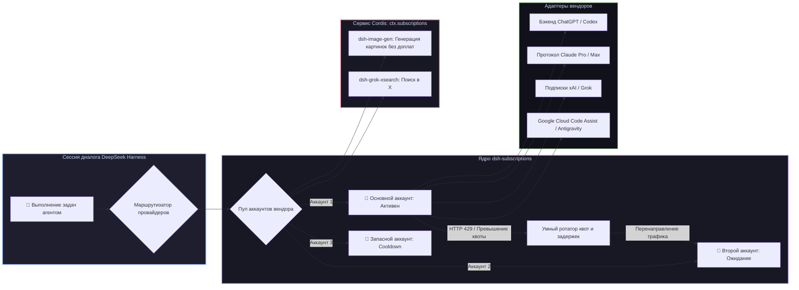

# 📦 @goodandready/dsh-subscriptions

<div align="center">

<h3>Мост персональных подписок на ИИ, ротация пула аккаунтов и безопасный OAuth без утечки токенов для DeepSeek Harness</h3>

<p align="center">
  <a href="https://www.npmjs.com/package/@goodandready/dsh-subscriptions"></a>
  <a href="LICENSE"></a>
  <a href="https://github.com/topics/dsh-plugin"></a>
  <a href="https://nodejs.org"></a>
</p>

<p align="center">
  <a href="https://goodandready.app/"></a>
</p>

<p align="center">
  <a href="README.md"><b>🇬🇧 English</b></a> •
  <a href="README.ru.md"><b>🇷🇺 Русский</b></a> •
  <a href="README.zh.md"><b>🇨🇳 中文说明</b></a>
</p>

</div>

---

## ⚡ Обзор

**`dsh-subscriptions`** подключает ваши платные персональные подписки на нейросети напрямую в **DeepSeek Harness** в качестве полноценных LLM-провайдеров.

Вместо поминутной оплаты дорогих API-ключей для повседневных задач агента плагин авторизует ваши существующие веб-подписки через OAuth PKCE. Дальше работают **пулы из нескольких аккаунтов** с автоматической ротацией при исчерпании лимитов, **упреждающее переключение квот** до того, как окно опустеет, и **внутрипроцессный сервис Cordis (`ctx.subscriptions`)**, который питает соседние плагины — например, [`dsh-image-gen`](https://github.com/GooDAnDReaDY/dsh-image-gen) и [`dsh-grok-xsearch`](https://github.com/GooDAnDReaDY/dsh-grok-xsearch) — без утечки токенов в сеть.



---

## ✨ Возможности

### 🌐 Встроенные вендоры подписок

| Ключ вендора | Тариф подписки | Протокол и возможности |
|---|---|---|
| `codex` | ChatGPT Plus / Pro | Стриминг Codex, вызов инструментов и генерация картинок |
| `claude` | Claude Pro / Max | Нативный протокол Claude Messages, трекинг расхода |
| `grok` | xAI / X Premium | Ответы с рассуждениями, проверка баланса и поиск в соцсети |
| `antigravity` | Google Cloud Code Assist | Движок Antigravity (`loadCodeAssist`, `streamGenerateContent`) |
| `kimi` | Moonshot Kimi | Вход по OAuth Device Flow, OpenAI-совместимый чат |
| `glm` | Z.ai GLM Coding Plan | Кодинг-эндпоинт GLM, живой монитор квоты |
| `cursor` | Cursor | Бэкенд Cursor, разбор дашборда расхода за период |
| `kiro` | AWS Kiro | Десктопный OAuth Kiro, стриминг кода |
| `copilot` | GitHub Copilot | Вход по GitHub Device Flow, chat completions |
| `qwen` | Alibaba Qwen (DashScope) | OpenAI-совместимый эндпоинт, вход по API-ключу |
| `ernie` | Baidu ERNIE (Qianfan) | Продление OAuth2-токена по связке API Key + Secret Key |
| `spark` | iFlytek Spark | OpenAI-совместимый HTTP API Spark |
| `jetbrains` | JetBrains AI Assistant | Релей JetBrains AI |
| `perplexity` | Perplexity Pro | Каталог моделей Sonar |
| `replit` | Replit Core | Replit AI API, вход по connect-токену |
| `cody` | Sourcegraph Cody Pro | Sourcegraph API, вход по access-токену |

**Новый вендор — это данные, а не код.** Семейство OpenAI-совместимых `/chat/completions` — `replit`, `spark`, `cody`, `qwen` — собирается фабрикой `createChatVendor()` (`lib/vendors/chat-vendor.js`) из профиля. Новому провайдеру из этого семейства нужен объект профиля, а не модуль:

```js
import { createChatVendor } from './chat-vendor.js'

const vendor = createChatVendor({
  id: 'my-provider',
  name: 'My Provider',
  apiBase: 'https://api.my-provider.example/v1',
  authorizeUrl: 'https://my-provider.example/keys',   // где пользователь берёт токен
  models: [{ id: 'my-model', name: 'My Model', contextWindow: 128000, maxTokens: 8192 }],
  authFields: ['accessToken', 'apiKey'],   // поля блоба, в порядке перебора
  authStyle: 'bearer',                     // или 'token', если вендор требует так
  missingAuth: 'My Provider requires an API key',
})
```

Тот же профиль работает и из конфигурации: запись в `customVendors` с `protocol: chat` принимает `baseUrl` и список моделей и не требует OAuth-тройки, которая нужна профилям Responses API:

```yaml
customVendors:
  - protocol: chat
    id: my-provider
    displayName: My Provider
    baseUrl: https://api.my-provider.example
    authStyle: bearer
    models:
      - id: my-model
        name: My Model
        contextWindow: 128000
        maxTokens: 8192
```

Провайдеры с действительно другим протоколом остаются рукописными — `claude` (Anthropic messages), `codex` (Responses + device login), `antigravity` (Cloud Code Assist), `grok`, `copilot` (режимы CLI и web), а также `glm`, `kimi`, `kiro`, `cursor`, `perplexity`, `jetbrains`, у каждого из которых свой эндпоинт квот. Тест `test/declarative-vendors.test.mjs` падает, если один из них попытаются свернуть в чат-фабрику, так что граница — это решение, а не случайность.

---

### 🔄 Ротация аккаунтов, кулдауны и квоты

* **Пулы из нескольких аккаунтов** — несколько аккаунтов на вендора (`CODEX_OAUTH_1`, `CODEX_OAUTH_2`, …) в одном пуле.
* **Автоматическое переключение при 429** — при превышении лимита трафик мгновенно уходит на следующий свободный аккаунт.
* **Упреждающее переключение (`switchAtRemaining`)** — смена аккаунта до падения в ноль, пока окно сброса ещё далеко.
* **Динамический расчёт кулдауна** — заголовки `Retry-After`, `x-ratelimit-reset`, даты ISO и метки времени задают момент возврата, поэтому аккаунт восстанавливается по сбросу окна, а не по фиксированной догадке.
* **Сетевые сбои — не вина аккаунта** — ошибка соединения (`connect-timeout`, `ECONNREFUSED`, `ENOTFOUND`, TLS, шлюз `5xx`) ничего не говорит о состоянии аккаунта. Она получает короткий ограниченный ретрай и не расходует кулдаун квоты, который заслуживает настоящий `429`. Причина кулдауна сохраняется, поэтому карточка и диагностика отличают недоступный upstream от исчерпанной квоты.
* **Кулдауны по семействам** — лимит на reasoning-модели охлаждает только семейство рассуждений этого аккаунта; обычные модели на нём продолжают работать.
* **Ограниченная очередь** — `enableQueue`, `accountMaxConcurrency`, `maxQueueSize` и `queueTimeoutMs` ограничивают число одновременных стримов на аккаунт, чтобы всплеск не превращался в стену `429`.
* **Привязка сессии с учётом кэша** — сохраняет привязку к подходящему аккаунту для провайдеров с кэшированием промптов (Claude, Codex, Antigravity, Grok) и немедленно снимает её при кулдауне, карантине или исчерпании квоты.
* **Здоровье и задержка по аккаунту** — каждый слот записывает реальную задержку (`latencyMs`) и оценку здоровья. Аккаунт, который ни разу не проверяли, показывается как `unprobed`, а не как идеальный балл, которого никто не измерял.
* **Живой отсчёт квоты** — карточки аккаунтов и виджет сессии показывают посекундный таймер до сброса скользящего окна (`five_hour`, `seven_day`, `primary_window`).
* **Каскадный фолбэк между вендорами** — порядок переключения провайдеров настраивается с интерактивным изменением приоритета в веб-интерфейсе.
* **Безопасные карты сброса квоты** — карточка Codex показывает, сколько карт сброса доступно и когда истекает ближайшая. Расход требует явной галочки подтверждения и пятисекундного удержания, а хостовый single-flight замок не даёт двойному клику израсходовать две карты. Вердикты сервера показываются дословно: `reset`, `nothing to reset`, `no usable credit`, `already redeemed`.

---

### 🛡️ Отказоустойчивость и фолбэк

* **Бесшовный локальный фолбэк (`ollamaFallback`)** — когда все аккаунты провайдера исчерпаны или недоступны и ничего ещё не выведено, чат продолжается на локальной модели (`ollamaFallbackModel` либо первой из `/api/tags`). Переключение пишется в журнал и в историю запросов как `kind: fallback`.
* **Локальный шлюз Ollama** — если Ollama отвечает по `ollamaBaseUrl` (по умолчанию `http://127.0.0.1:11434`), он появляется в нативном селекторе моделей с моделями из `/api/tags`. Ключ не нужен, и это работает вообще без интернета.
* **Устойчивость стримов** — таймаут простоя SSE, детекция пустого ответа и ретрай с ротацией аккаунта, чтобы зависшее соединение не обрывало ход.
* **Превентивный heartbeat токенов** — фоновое обновление идёт *до* истечения, поэтому первый запрос после паузы не платит за обновление.
* **Гарантированные таймауты** — проверки вендора и запросы квоты несут явные таймеры прерывания, так что зависший сокет не блокирует пул во время сбоя.
* **Структурированная обработка ошибок** — пустых `catch` нет: каждая проигнорированная ошибка проходит через `bestEffort` в диагностический буфер, а не исчезает.
* **Канонический учёт токенов** — все потоковые адаптеры приводят расход вендора к стандартному `TokenUsage` DSH, значения гарантированно целые и неотрицательные. Неизвестный или частичный ответ даёт ноль, никогда `NaN`, а адаптер проверяет данные до записи сессии.

---

### 🩺 Диагностика, здоровье и телеметрия

* **Доктор авторизации** — разбирает ошибки аутентификации и подключения (Cloudflare `403` / геоблокировка, истёкшие токены, отозванные сессии, нехватка разрешений на модель, исчерпанные квоты) и показывает вердикт с конкретной рекомендацией в карточке аккаунта.
* **Проверка по требованию** — один маршрут `POST /dsh-subscriptions/probe?mode=check|ping|smoke` отвечает на три вопроса: `check` обновляет креденшел, отдаёт квоту и снимает автоматический кулдаун или карантин; `ping` измеряет задержку; `smoke` сам выбирает подключённый аккаунт. Успешный `check` не трогает ручную парковку — это решение оператора.
* **Мастер пошаговой диагностики** — чек-лист проверки ключей, доступности сети и прокси, свежести токена и каталога моделей, без платного инференса и с маскированием секретов.
* **Оповещения о лимитах и квотах** — настраиваемые пороги (`alertThresholds`) дают всплывающие уведомления и опциональные вебхуки при входе в карантин, восстановлении и пересечении порога квоты.
* **Живая строка статуса** — доступность хоста с задержкой, число подключённых аккаунтов и размер пула в шапке карточки.
* **Панель телеметрии сессии** — число запросов, доля успешных, средняя задержка и последняя активность, плюс компактный каталог моделей с размером контекста и тегами возможностей.
* **Инспектор последних ошибок** — ограниченный буфер последних сбоев с удалёнными секретами, доступный и в интерфейсе, и в диагностическом отчёте.
* **Трассировка решений** — каждый выбор аккаунта, шаг ротации, причина отказа и каскадный переход фиксируются по ходу дела, а не восстанавливаются задним числом, и выводятся в телеметрии и отчёте.
* **Анонимизированный отчёт** — один клик даёт отчёт (версии плагина и рантайма, ОС, счётчики по вендорам, агрегаты HTTP-статусов, последние ошибки с причинами и таймингами, несекретные настройки), готовый для вставки в issue. Токены, email, имена учётных записей и адреса прокси исключены, и это проверяется тестами.
* **Метрики** — сводка, удобная для скрейпинга, для тех, кто наблюдает, а не нажимает.
* **Неблокирующая история** — запись на диск дебаунсится асинхронно, чтобы интенсивный стриминг не останавливал event loop.

---

### 🔒 Креденшелы, приватность и прокси

* **Нулевая утечка токенов** — OAuth-токены никогда не отдаются по HTTP и не рендерятся в интерфейсе. Карточка получает только маскированные имена, состояние здоровья и полосы квоты.
* **Хранилище хоста** — токены лежат в хранилище креденшелов хоста (`$DSH_HOME/.credentials.yaml`), шифруются службой хоста и опционально запечатываются мастер-ключом.
* **Маскирование (`privacyMask`)** — один тумблер скрывает персональные данные во всём интерфейсе: email отображается как `j***n@example.com` в списках, статусах и результатах проверок. Маскирование идёт на сервере, поэтому данные не утекают и через ответы API, а сами записи не перезаписываются.
* **Прокси на аккаунт (`proxyUrl`)** — каждый слот принимает свой `http://`, `https://` или `socks5://[user:pass@]host:port`. Через него идут обновление токенов, проверки вендора и запросы моделей этого аккаунта. Пусто — прямое соединение.
* **Проверка прокси в один клик** — реальный запрос к базовому URL вендора через прокси, с задержкой или причиной отказа.
* **Тайминги запросов** — каждая запись истории несёт длительность, поэтому прямое соединение и прокси можно сравнить во времени.
* **Экспорт, импорт и синхронизация хранилища** — зашифрованный бэкап через `/vault/export` и `/vault/import`, плюс опциональная синхронизация через WebDAV, Gist или S3 и снимки состояния, которые можно восстановить.
* **Редактирование до сохранения** — буфер ошибок и все отчёты вырезают bearer-токены, API-ключи, JWT и `key=value`-креденшелы до записи и выдачи.
* **Правила доверия к хостам** — адреса кастомных вендоров и переопределения базовых URL допускаются только по `https://`, открытый `http://` принимается лишь на loopback, поэтому bearer-токен нельзя увести на недоверенный хост.

---

### 🔐 Вход без браузера

* **Автоматический loopback-callback (`autoLoopback`, включён по умолчанию)** — если redirect URI вендора указывает на loopback, плагин сам поднимает временный локальный HTTP-сервер и ловит callback. Ручная вставка остаётся запасным путём.
* **Вход по коду устройства** — на полностью headless-машине плагин запрашивает короткий код, вы открываете страницу подтверждения на любом устройстве, а плагин сам завершает PKCE-обмен. Поддерживается для Codex и Grok (RFC 8628).
* **Ручная вставка для headless** — если ни loopback, ни device flow недоступны, вставьте итоговый redirect URL или authorization code в карточку аккаунта.
* **Импорт существующих сессий** — поиск уже имеющихся на машине креденшелов (конфиги CLI вендоров, `hosts.yml` GitHub CLI, диспетчер учётных данных Windows) вместо повторного входа.
* **Надёжное обновление** — импортированные CLI-сессии продолжают обновляться, а не умирают через час, и отсутствующий или неверный client secret называется по имени, а не тонет в общем `400`.
* **Поддержка десктопа** — схемы приложения (`dsh-app://`) проходят проверку равенства хоста, при этом проверка loopback-сокета и закрытая по умолчанию защита от cross-site остаются в силе.

---

### 🧠 Рассуждения, усилие и каталог моделей

* **Уровень рассуждений** — модели объявляют поддерживаемые уровни из живого каталога, а выбранное значение передаётся в протоколе каждого вендора (Codex `/responses`, адаптивное мышление Claude, Grok, `thinkingConfig` Antigravity).
* **Управление в рамках сессии** — глубина (`low` / `medium` / `high` / `max`) или отключение (`off`) настраиваются на диалог через `GET`, `POST` и `DELETE /dsh-subscriptions/session-reasoning`.
* **Безопасность при смене модели** — параметры рассуждений автоматически подавляются при переходе с reasoning-модели на обычную, что предотвращает `400` от upstream.
* **Адаптивное мышление Claude** — уровни усилия отбираются по модели; модель без поддержки адаптивного мышления чисто отклоняет параметр, и запрос идёт без него, а не падает с `400`.
* **Детализация (`codexVerbosity`)** — `low` / `medium` / `high` передаётся для reasoning-моделей Codex; пусто — значение протокола по умолчанию.
* **Fast Mode (`codexFastMode`)** — запрашивает приоритетный тир обслуживания (быстрее, дороже); у чипа активной подписки появляется префикс `⚡`.
* **Динамическое обнаружение моделей** — синхронизация в один клик запрашивает живые `/v1/models`, поэтому новые и плановые модели появляются без ожидания релиза плагина.
* **Гигиена каталога** — `hideDeprecatedModels` убирает id с `test` / `preview` / `dev` / `alpha` / `beta` / `legacy` из селектора.
* **Один источник размера контекста** — правила моделей, апгрейды тарифа и дефолты провайдера разрешаются через один модуль, поэтому бюджет сжатия и бейджи селектора не могут разойтись.
* **Tiered-модели** — Antigravity Flash предлагает уровни мышления high, medium и low с соответствующим маппингом на upstream, а восстановленные вызовы инструментов несут подпись, которую ждёт Gemini, поэтому многоходовый tool calling не падает на валидации.
* **Бейджи тарифа** — метки плана и тира показываются рядом с моделью и нормализуются по вендору.
* **Атрибуция биллинга** — состояние биллинга Claude хранится по аккаунтам, а не глобально, поэтому пул не смешивает атрибуцию между подписками.

---

### 🎛️ Карточка настроек, режимы и виджеты

* **Режимы (`experienceMode`)** — один селектор в начале настроек маршрутизации решает, сколько поверхности политик показывает карточка. Это **вид**, а не второе хранилище: переключение режима ничего не пишет и не сбрасывает — вернувшись из Simple в Power, вы найдёте все значения на своих местах.
  * **Simple** — для одного-двух аккаунтов. Ротация, кулдаун, привязка кэша и оповещения о квоте.
  * **Balanced** (по умолчанию) — добавляет слив перед сбросом, тайминг обновления токенов, прогрев, аренду аккаунта и пул прокси. Проактивная защита, расписания, пресеты маршрутизации и политики инструментов остаются в одном раскрытии.
  * **Power** — все настройки, включая проактивную защиту квоты, правила по времени суток, пресеты маршрутизации и политики инструментов.
  * Группа, скрытая текущим режимом, говорит, сколько настроек она придерживает, и указывает на Power, поэтому ничего не выглядит молча сломанным. Неизвестное значение падает в Balanced, но никогда в Power.
* **Всё основное — в карточке** — слоты аккаунтов, `autoLoopback`, `privacyMask`, виджеты квоты, оповещения об истечении, fast mode, детализация, фолбэк Ollama, список разрешённых инструментов по провайдерам, тайминги транспорта и интервалы кулдауна и проверок. В `settings.yaml` остаются только протокольная идентичность (OAuth client id, redirect URI, переопределения базовых URL) и секреты.
* **Индикатор квоты в композере (`composerQuota`)** — рядом с переключателем модели. Режимы: `off`, `percent`, `bar` (мини-полоса с зелёным, янтарным и красным порогом) и `forecast` (прогноз запаса по взвешенной скорости расхода; говорит `calibrating…`, пока не набрано достаточно замеров, и `no usage`, когда расход нулевой). Скрывается для локальной Ollama и когда ничего не активно.
* **Пилюля SUBS** — `SUBS (N)` в заголовке сессии со светодиодом здоровья пула (зелёный ниже 50% максимума, янтарный 50–90%, красный от 90%, серый когда ничего не подключено). Клик открывает консоль со списком аккаунтов, их кулдауном и квотой.
* **Перетаскиваемый HUD** — плавающий пузырь с кольцевым индикатором активного баланса на `shell.overlay`, смонтированный через портал. Тянется куда угодно, примагничивается к краю экрана в пределах 24px, выглядывает из-за края и запоминает позицию.
* **Метр квоты в сайдбаре** — опциональный постоянный индикатор в подвале сайдбара.
* **Переключатель скорости** — опциональная кнопка быстрого тира Codex в композере.
* **Обновление в один клик** — в шапке видна текущая версия, бейдж доступного обновления и кнопка обновления с обратным отсчётом до перезапуска. Эндпоинты обновления требуют loopback, отдельный заголовок и проверку same-origin.

---

### 🧩 Внутрипроцессный сервис Cordis (`ctx.subscriptions`)

Соседние плагины обращаются к подпискам в памяти, без HTTP-перехода и не видя токен:

```javascript
const res = await ctx.subscriptions.request('codex', '/backend-api/codex/images/generations', {
  method: 'POST',
  body: JSON.stringify({ prompt: 'Cyberpunk landscape', size: '1024x1024' }),
})
```

* **Нулевой оверхед** — без промежуточного HTTP, токены остаются в памяти процесса.
* **Строгий белый список путей** — вызовы ограничены проверенными эндпоинтами вендоров, поэтому сервис не превращается в SSRF-примитив.
* **Генерация изображений** — `ctx.subscriptionImages` отдаёт доступность, размеры и генерацию для провайдеров, которые это умеют, через тот же слой политик, что и нативный инструмент.

---

### 🔌 Инструменты для агента

* **`image_generate`** — рисует картинку на активной подписке, опционально с одним–пятью референсами для редактирования, с учётом медиа-политики провайдера и ротации аккаунтов; отказ по политике возвращается ошибкой, а не пустым результатом.
* **Локальный tool calling** — драйвер Copilot CLI превращает вывод процесса в потоковые чанки и дельты вызовов инструментов, поэтому инструменты работают и в режиме CLI без эмуляции токенов.

---

## 📦 Быстрая установка

```bash
dsh plugin --profile web add @goodandready/dsh-subscriptions
```

> [!IMPORTANT]
> После установки перезапустите DSH Web UI (`systemctl --user restart dsh-web`) и откройте **«Настройки → Плагины → Настройки плагинов → Subscriptions»**, чтобы привязать аккаунты.

---

## ⚙️ Пример конфигурации (`settings.yaml`)

> [!TIP]
> **Карточка в UI против YAML.** Всё, что вы вероятно станете менять — слоты аккаунтов, `autoLoopback`, `privacyMask`, виджеты квоты, оповещения об истечении, fast mode, детализацию, фолбэк Ollama, список разрешённых инструментов, тайминги транспорта и интервалы кулдауна и проверок — редактируется в карточке (**«Настройки → Плагины → Настройки плагинов → Subscriptions»**). В `settings.yaml` остаются только протокольная идентичность (OAuth client id, redirect URI, переопределения базовых URL) и секреты.

```yaml
dsh-subscriptions:
  switchAtRemaining: 1
  cooldownMs: 60000
  autoLoopback: true        # автоматически ловить loopback-callback
  privacyMask: false        # маскировать email и учётные записи в UI
  experienceMode: balanced  # simple | balanced | power — сколько политик показывает карточка
  ollamaBaseUrl: http://127.0.0.1:11434  # локальный шлюз Ollama
  ollamaFallback: true      # бесшовный фолбэк при исчерпании всех аккаунтов
  ollamaFallbackModel: ''   # пусто = первая модель из /api/tags
  hideDeprecatedModels: false # фильтровать test/preview/beta/legacy id моделей
  codexVerbosity: ''        # low | medium | high (text.verbosity)
  codexFastMode: false      # service_tier priority (скоростной тир 1.5x)
  composerQuota: 'off'      # индикатор в строке ввода: off | percent | bar | forecast
  sidebarQuotaDisplay: 'off' # метр в сайдбаре: off | auto | always
  showSpeedToggle: false    # кнопка скорости Codex в композере
  showSubsPill: false       # индикатор SUBS в заголовке чата
  enableToasts: true        # всплывающие уведомления при событиях карантина и квот
  enableQueue: true         # ограниченная очередь параллельных запросов
  accountMaxConcurrency: 2  # макс. число параллельных стримов на аккаунт
  maxQueueSize: 20          # макс. глубина очереди до сброса нагрузки
  queueTimeoutMs: 30000     # таймаут ожидания слота в очереди в мс
  connectAttemptTimeoutMs: 1500 # минимум на попытку соединения для сетевых вызовов плагина
  rateLimitMaxWaitMs: 0     # верхняя граница ожидания окна лимита
  rateLimitWait: true       # false = падать быстро вместо ожидания окна
  toolPolicies:             # какие инструменты разрешены, по провайдерам
    codex: { web: true, image: true, video: false, search: true, tools: true }
  # Поля слота: expiresAt (ms), proxyUrl (http/https/socks5://)
  accounts:
    codex:
      - ref: CODEX_OAUTH_1
        label: "Рабочий Pro-аккаунт"
      - ref: CODEX_OAUTH_2
        label: "Личный Plus-аккаунт"
    claude:
      - ref: CLAUDE_OAUTH_1
        label: "Claude Max"
    grok:
      - ref: GROK_OAUTH_1
        label: "X Premium"
```

### Кастомные провайдеры и доверие хостам

* Записи `customVendors` требуют `https://` для `authUrl`, `tokenUrl` и `baseUrl`. Открытый `http://` допускается только для loopback-хостов (`localhost`, `127.0.0.1`, `::1`).
* Записи с `protocol: chat` требуют `id`, `baseUrl` и `models`, а опционально принимают `authStyle` (`bearer` или `token`), `authFields`, `missingAuth`, `tools`, `generationParams` и `modelAliases`.
* Переопределение Grok `baseUrl` должно указывать на `api.x.ai`, `grok.com` / `*.grok.com` или loopback; остальные хосты отклоняются с `GROK_UNTRUSTED_HOST`, чтобы bearer-токен не покидал доверенную инфраструктуру xAI.
* Импорт Antigravity CLI требует явного `antigravityClientSecret`; встроенный дефолт удалён, а отсутствующий client id сообщается явно, вместо отправки браузера на падающую страницу согласия.
* `copilotCliPath` должен указывать на бинарь `copilot`, `github-copilot-cli` или `copilot-cli`; кастомные обёртки переименуйте.
* Бэкап креденшелов использует `/vault/export` и `/vault/import`; устаревшие маршруты `/export`, `/import`, `/export-backup` и `/import-backup` удалены.

---

## 🔌 HTTP API

Ниже — полный сгенерированный каталог маршрутов. Чаще всего вручную вызывают эти:

| Маршрут | Метод | Назначение |
|---|---|---|
| `/dsh-subscriptions/status` | GET / DELETE | Состояние пула; `DELETE` очищает оповещения |
| `/dsh-subscriptions/probe?mode=check\|ping\|smoke` | POST | Проверка аккаунта: `check` обновляет и снимает состояние, `ping` измеряет задержку, `smoke` сам выбирает подключённый аккаунт |
| `/dsh-subscriptions/diagnostics` | GET | Анонимизированный диагностический отчёт |
| `/dsh-subscriptions/diagnostic-wizard` | POST | Пошаговая диагностика |
| `/dsh-subscriptions/proxy-check` | POST | Проверка задержки прокси слота |
| `/dsh-subscriptions/quarantine/park` | POST | Отправить аккаунт в карантин |
| `/dsh-subscriptions/quarantine/probe` | POST | Прогревочный зонд или досрочный вывод |
| `/dsh-subscriptions/alerts` | GET | Последние оповещения |

<!-- routes:begin -->

Плагин регистрирует 59 exact-маршрутов на web-сервере DSH. Таблица генерируется из `lib/` скриптом `scripts/route-doc.mjs`; не редактируйте её вручную. Если не указано иное, маршруты принимают same-origin или loopback запросы, а пишущие запросы обязаны нести `Origin` или `Referer`, совпадающий с хостом (#782).

| Маршрут | Methods | Группа |
|---|---|---|
| `/dsh-subscriptions/accounts/next-slot` | POST | accounts |
| `/dsh-subscriptions/accounts/switch-organization` | POST | accounts |
| `/dsh-subscriptions/accounts/sync-models` | POST | accounts |
| `/dsh-subscriptions/alerts` | GET | alerts |
| `/dsh-subscriptions/analytics` | GET | analytics |
| `/dsh-subscriptions/analytics/savings` | GET | analytics |
| `/dsh-subscriptions/analyze-session` | POST | analyze-session |
| `/dsh-subscriptions/client.css` | GET | client.css |
| `/dsh-subscriptions/config` | GET, PUT | config |
| `/dsh-subscriptions/diagnostic-wizard` | POST | diagnostic-wizard |
| `/dsh-subscriptions/diagnostics` | GET | diagnostics |
| `/dsh-subscriptions/diagnostics/errors/clear` | POST | diagnostics |
| `/dsh-subscriptions/discover-local` | GET | discover-local |
| `/dsh-subscriptions/health` | GET | health |
| `/dsh-subscriptions/heartbeat/run` | POST | heartbeat |
| `/dsh-subscriptions/history` | GET | history |
| `/dsh-subscriptions/import-local` | POST | import-local |
| `/dsh-subscriptions/import-token` | POST | import-token |
| `/dsh-subscriptions/instructions` | GET | instructions |
| `/dsh-subscriptions/logout` | POST | logout |
| `/dsh-subscriptions/metrics` | GET | metrics |
| `/dsh-subscriptions/models` | GET | models |
| `/dsh-subscriptions/oauth/callback` | GET | oauth |
| `/dsh-subscriptions/oauth/complete` | POST | oauth |
| `/dsh-subscriptions/oauth/device/poll` | POST | oauth |
| `/dsh-subscriptions/oauth/device/start` | POST | oauth |
| `/dsh-subscriptions/oauth/headless-info` | GET | oauth |
| `/dsh-subscriptions/oauth/headless-redirect` | GET | oauth |
| `/dsh-subscriptions/oauth/start` | GET | oauth |
| `/dsh-subscriptions/passport` | GET | passport |
| `/dsh-subscriptions/presets` | POST | presets |
| `/dsh-subscriptions/presets/apply` | POST | presets |
| `/dsh-subscriptions/probe` | GET | probe |
| `/dsh-subscriptions/provider-packs/validate` | POST | provider-packs |
| `/dsh-subscriptions/proxy-check` | POST | proxy-check |
| `/dsh-subscriptions/proxy/` | GET, POST | proxy |
| `/dsh-subscriptions/quarantine/park` | POST | quarantine |
| `/dsh-subscriptions/quarantine/probe` | POST | quarantine |
| `/dsh-subscriptions/queue` | GET | queue |
| `/dsh-subscriptions/quota-forecast` | GET | quota-forecast |
| `/dsh-subscriptions/reset-credits` | GET | reset-credits |
| `/dsh-subscriptions/reset-credits/consume` | POST | reset-credits |
| `/dsh-subscriptions/reset-credits/prepare` | POST | reset-credits |
| `/dsh-subscriptions/routing/trace` | GET | routing |
| `/dsh-subscriptions/session-reasoning` | DELETE, GET, POST | session-reasoning |
| `/dsh-subscriptions/sources` | GET | sources |
| `/dsh-subscriptions/speed` | GET, POST | speed |
| `/dsh-subscriptions/status` | DELETE, GET | status |
| `/dsh-subscriptions/subscriptions` | GET | subscriptions |
| `/dsh-subscriptions/telemetry` | GET | telemetry |
| `/dsh-subscriptions/usage` | GET | usage |
| `/dsh-subscriptions/vault/export` | POST | vault |
| `/dsh-subscriptions/vault/import` | GET | vault |
| `/dsh-subscriptions/vault/snapshots` | GET, POST | vault |
| `/dsh-subscriptions/vault/snapshots/restore` | POST | vault |
| `/dsh-subscriptions/vault/sync/pull` | POST | vault |
| `/dsh-subscriptions/vault/sync/push` | POST | vault |
| `/dsh-subscriptions/vault/sync/status` | GET | vault |
| `/dsh-subscriptions/webhook/test` | POST | webhook |

<!-- routes:end -->

---

## 🌐 Локализация

Исходный язык плагина — только английский. Каждая пользовательская строка проходит через механизм локали и поставляется с английским исходником и переводом на упрощённый китайский. Русский и другие языки во время работы предоставляют отдельные языковые плагины (например, `dsh-russian-lang`), которые переводят зарегистрированные ключи локали — сам пакет русских строк не содержит.

## 🪞 Зеркало

Репозиторий на GitHub — обезличенное зеркало распространения: в нём только продуктовые файлы, без тестов, исходников сборки и внутреннего инструментария. Поэтому `npm test` запускается только в каноническом репозитории Gitea; для разработки используйте опубликованный пакет или дерево Gitea.

---

## 📄 Лицензия

MIT © [GooDAnDReaDY](https://github.com/GooDAnDReaDY)
