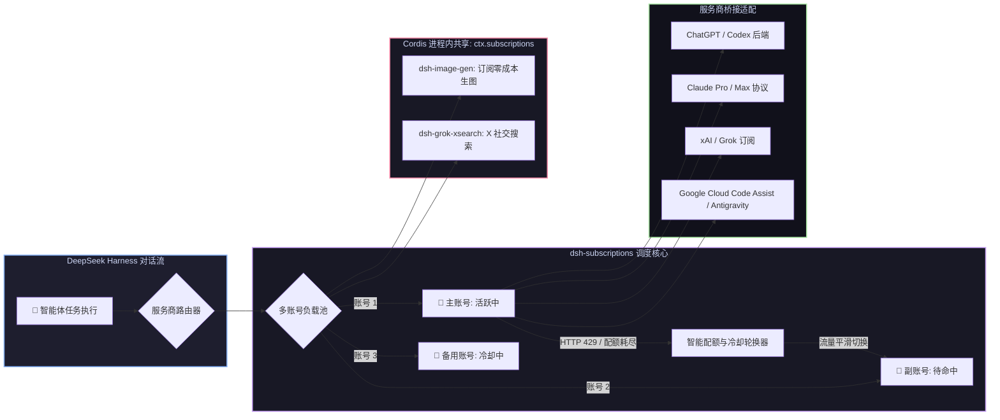

# 📦 @goodandready/dsh-subscriptions

<div align="center">

<h3>DeepSeek Harness 个人 AI 订阅桥接、多账号池轮换与零泄漏 OAuth 插件</h3>

<p align="center">
  <a href="https://www.npmjs.com/package/@goodandready/dsh-subscriptions"></a>
  <a href="LICENSE"></a>
  <a href="https://github.com/topics/dsh-plugin"></a>
  <a href="https://nodejs.org"></a>
</p>

<p align="center">
  <a href="https://goodandready.app/"></a>
</p>

<p align="center">
  <a href="README.md"><b>🇬🇧 English</b></a> •
  <a href="README.ru.md"><b>🇷🇺 Русский</b></a> •
  <a href="README.zh.md"><b>🇨🇳 中文说明</b></a>
</p>

</div>

---

## ⚡ 插件概览

**`dsh-subscriptions`** 将您现有的付费个人 AI 订阅接入 **DeepSeek Harness**，作为第一类模型服务商。

无需为日常智能体任务支付昂贵的 API 按量费用：插件通过 OAuth PKCE 鉴权您已有的网页订阅，然后提供**多账号轮换池**（遇到限流或冷却时自动换号）、**前置配额切换**（在窗口耗尽前换号），以及**进程内 Cordis 服务 (`ctx.subscriptions`)**，为 [`dsh-image-gen`](https://github.com/GooDAnDReaDY/dsh-image-gen)、[`dsh-grok-xsearch`](https://github.com/GooDAnDReaDY/dsh-grok-xsearch) 等插件供能，全程 Token 不出进程。



---

## ✨ 功能

### 内置订阅供应商

| 供应商 | 订阅级别 | 协议与能力 |
|---|---|---|
| `codex` | ChatGPT Plus / Pro | 流式响应、工具调用、图像生成 |
| `claude` | Claude Pro / Max | 原生 Messages 协议、用量跟踪 |
| `grok` | xAI / X Premium | 实时推理、计费检查、社交搜索 |
| `antigravity` | Google Cloud Code Assist | `loadCodeAssist`、`streamGenerateContent` |
| `kimi` | Moonshot Kimi | OAuth Device Flow 登录、OpenAI 兼容聊天 |
| `glm` | Z.ai GLM Coding Plan | GLM 编码端点、实时配额监控 |
| `cursor` | Cursor | Cursor 后端、用量面板解析 |
| `kiro` | AWS Kiro | Kiro 桌面 OAuth、流式输出 |
| `copilot` | GitHub Copilot | GitHub Device Flow 登录、聊天补全 |
| `qwen` | 阿里 Qwen（DashScope） | OpenAI 兼容端点、API Key 认证 |
| `ernie` | 百度 ERNIE（千帆） | OAuth2 令牌刷新（API Key + Secret Key） |
| `spark` | 讯飞星火 | OpenAI 兼容 HTTP API |
| `jetbrains` | JetBrains AI Assistant | JetBrains AI 中继 |
| `perplexity` | Perplexity Pro | Sonar 模型目录 |
| `replit` | Replit Core | Replit AI API、connect-token 认证 |
| `cody` | Sourcegraph Cody Pro | Sourcegraph API、access-token 认证 |

**新增供应商是数据，不是代码。** OpenAI 兼容的 `/chat/completions` 家族——`replit`、`spark`、`cody`、`qwen`——由 `createChatVendor()`（`lib/vendors/chat-vendor.js`）从配置档构建。该家族的新供应商只需要一个配置对象，不需要新模块：

```js
import { createChatVendor } from './chat-vendor.js'

const vendor = createChatVendor({
  id: 'my-provider',
  name: 'My Provider',
  apiBase: 'https://api.my-provider.example/v1',
  authorizeUrl: 'https://my-provider.example/keys',   // 用户获取令牌的位置
  models: [{ id: 'my-model', name: 'My Model', contextWindow: 128000, maxTokens: 8192 }],
  authFields: ['accessToken', 'apiKey'],   // 依次尝试的凭据字段
  authStyle: 'bearer',                     // 或用 'token'，视供应商要求
  missingAuth: 'My Provider requires an API key',
})
```

同样形状也可直接写进配置：`customVendors` 中带 `protocol: chat` 的条目只需 `baseUrl` 和模型列表，无需 Responses API 配置档所必需的 OAuth 三项：

```yaml
customVendors:
  - protocol: chat
    id: my-provider
    displayName: My Provider
    baseUrl: https://api.my-provider.example
    authStyle: bearer
    models:
      - id: my-model
        name: My Model
        contextWindow: 128000
        maxTokens: 8192
```

协议确实不同的供应商仍保持手写——`claude`（Anthropic messages）、`codex`（Responses + 设备登录）、`antigravity`（Cloud Code Assist）、`grok`、`copilot`（CLI 与 web 两种模式），以及 `glm`、`kimi`、`kiro`、`cursor`、`perplexity`、`jetbrains`，各自有独立的配额端点。若把其中之一并入聊天工厂，`test/declarative-vendors.test.mjs` 会失败，因此这条边界是明确决定而非偶然。

---

### 多账号轮换、冷却与配额

* **多账号池** — 同一供应商可挂多个账号（`CODEX_OAUTH_1`、`CODEX_OAUTH_2`……）并统一调度。
* **429 自动切换** — 账号触及限流（`429`、`RATE_LIMIT`、`QUOTA_EXCEEDED`）时，流量立即转到下一个健康账号。
* **前置配额切换 (`switchAtRemaining`)** — 在账号归零前换号，只要窗口重置还很远。
* **动态冷却计算** — 由上游响应头（`Retry-After`、`x-ratelimit-reset`、ISO 日期、时间戳）决定何时恢复，因此账号随窗口重置回归，而不是按固定猜测。
* **网络故障不是账号故障** — 连接层错误（`connect-timeout`、`ECONNREFUSED`、`ENOTFOUND`、TLS、网关 `5xx`）与账号状态无关：只做短暂的有限重试，绝不消耗真正 `429` 才应得的配额冷却。冷却会记录**原因**，因此卡片与诊断报告能区分「上游不可达」与「配额耗尽」。
* **按模型家族冷却** — 推理模型触发限流时只冷却该账号的推理家族，同账号的普通模型继续可用。
* **有界并发队列** — `enableQueue`、`accountMaxConcurrency`、`maxQueueSize`、`queueTimeoutMs` 限制单账号并发流数量，避免瞬时并发变成一片 `429`。
* **考虑缓存的会话粘性** — 为支持提示缓存的供应商（Claude、Codex、Antigravity、Grok）保持会话亲和以复用缓存，并在账号进入冷却、隔离或配额耗尽时立即释放。
* **账号级健康与延迟** — 每个槽位记录真实往返延迟（`latencyMs`）与健康评分。从未探测过的账号显示 `unprobed`，而不是无人测量的满分。
* **实时配额倒计时** — 账号卡片与会话胶囊按秒显示滚动窗口（`five_hour`、`seven_day`、`primary_window`）的重置剩余时间。
* **跨供应商级联回退** — 在 Web UI 中通过 ▲/▼ 交互调整服务商回退顺序。
* **安全的配额重置卡** — Codex 卡片显示剩余重置卡数量与最早到期时间。消耗需显式勾选确认并保持五秒，宿主端 single-flight 锁保证双击无法消耗两张。服务端结论原样展示：`reset`、`nothing to reset`、`no usable credit`、`already redeemed`。

---

### 弹性与回退

* **无缝本地回退 (`ollamaFallback`)** — 某供应商所有账号耗尽或不可达、且尚未输出任何内容时，对话自动切到本地模型（`ollamaFallbackModel` 或 `/api/tags` 首个模型），并记入请求历史（`kind: fallback`）。
* **本地 Ollama 网关** — 本地 Ollama 可达时（`ollamaBaseUrl`，默认 `http://127.0.0.1:11434`）自动出现在原生模型选择器中（模型来自 `/api/tags`），无需密钥，断网也能用。
* **流式自愈** — SSE 空闲超时、空响应检测与带账号轮换的短暂重试，避免连接卡死毁掉整轮对话。
* **主动令牌心跳** — 在过期**之前**后台刷新，使间隔后的首个请求不必额外等待。
* **强制超时** — 供应商探测与配额查询带显式中断计时器，故障期间挂死的套接字不会拖住整个池。
* **结构化错误处理** — 没有空 `catch`：每个被忽略的失败都经 `bestEffort` 进入诊断缓冲，不会无声消失。
* **统一 Token 记账** — 各流式适配器把供应商用量映射为 DSH 规范的 `TokenUsage`，并保证为非负整数。未知或不完整的载荷给出零，绝不会是 `NaN`；适配器在会话落盘前完成校验。

---

### 诊断、健康与遥测

* **鉴权诊断器** — 解析服务商鉴权与连接错误（Cloudflare `403` / 地区限制、令牌过期、会话失效、模型权限不足、配额耗尽），并在账号卡片给出结论与可执行建议。
* **按需探测** — 单一接口 `POST /dsh-subscriptions/probe?mode=check|ping|smoke` 回答三个问题：`check` 刷新凭据、返回配额并解除自动冷却或隔离；`ping` 测量延迟；`smoke` 自动挑选已连接账号。成功 `check` 不会动用手动暂停，因为那是操作者的决定。
* **分步诊断向导** — 检查凭据、网络与代理可达性、令牌新鲜度、模型目录可达性的清单，全程无付费推理，并完整遮蔽密钥。
* **限流与配额告警** — 可配置阈值（`alertThresholds`）在账号进入隔离、恢复、越过配额阈值时发出应用内提醒，并可选择推送 webhook。
* **实时状态栏** — 卡片顶部显示宿主可达性与延迟、已连接账号数、池大小。
* **会话遥测面板** — 请求数、成功率、平均延迟与最近活动，另有带上下文窗口与能力标签的精简模型目录。
* **最近错误检查器** — 内存中有界的脱敏错误缓冲，界面与诊断报告都能查看。
* **决策追踪** — 每次账号选择、轮换步骤、失败原因与级联回退都在发生时记录，而非事后推导，并暴露在遥测与诊断报告中。
* **匿名诊断报告** — 一键生成报告（插件与运行时版本、系统、各供应商健康计数、HTTP 状态聚合、带原因与耗时的最近失败、非敏感配置），可直接粘贴进 issue。令牌、邮箱、凭据名与代理地址一律排除，并有测试强制。
* **指标接口** — 便于抓取的摘要，给更愿意观察而非点击的人。
* **非阻塞历史** — 落盘经过异步防抖，高吞吐流式不会阻塞事件循环。

---

### 凭据、隐私与代理

* **零令牌泄漏** — OAuth 令牌绝不通过 HTTP 返回，也不在界面渲染。卡片只收到脱敏名称、连接健康与配额条。
* **宿主托管存储** — 令牌存放在宿主凭据存储（`$DSH_HOME/.credentials.yaml`），由宿主服务加密，可选主密钥封装。
* **隐私遮蔽 (`privacyMask`)** — 一个开关在整个界面遮蔽个人数据：邮箱在账号列表、状态标签与检查结果中显示为 `j***n@example.com`。遮蔽在服务端完成，因此不会通过 API 响应泄漏，且底层数据不会被改写。
* **账号级 HTTP/SOCKS 代理 (`proxyUrl`)** — 每个槽位可配自己的 `http://`、`https://` 或 `socks5://[user:pass@]host:port`。该账号的令牌刷新、供应商检查与模型请求都走它。留空即直连。
* **一键代理检测** — 经代理向供应商基础地址发真实请求，报告往返延迟或失败原因。
* **请求耗时** — 每条历史记录带耗时，便于长期对比直连与代理。
* **保险库导出、导入与同步** — 通过 `/vault/export` 与 `/vault/import` 加密备份，可选 WebDAV、Gist 或 S3 同步，并支持可恢复的时间点快照。
* **落盘前脱敏** — 错误缓冲与所有报告在存储或返回前剥离 bearer 令牌、API 密钥、JWT 与 `key=value` 凭据。
* **主机信任规则** — 自定义供应商地址与基础 URL 覆盖仅允许 `https://`，明文 `http://` 只接受回环地址，因此 bearer 令牌无法被引向不可信主机。

---

### 无浏览器登录

* **回环自动回调 (`autoLoopback`，默认开启)** — 供应商重定向指向回环地址时，插件自动启动临时本地 HTTP 服务器接收回调，无需粘贴链接；手动粘贴始终作为备用。
* **设备码登录** — 完全无浏览器的机器上请求短码，在任意设备打开验证页，插件自动完成 PKCE 交换。支持 Codex 与 Grok（RFC 8628）。
* **无头粘贴回退** — 回环与设备码都不可用时，把重定向 URL 或授权码粘贴进账号卡片。
* **导入已有会话** — 发现机器上已有的凭据（供应商 CLI 配置、GitHub CLI `hosts.yml`、Windows 凭据管理器），无需重新登录。
* **可靠刷新** — 导入的 CLI 会话持续刷新，不会一小时后失效；缺失或错误的客户端密钥会明确指出，而不是淹没在泛泛的 `400` 里。
* **桌面端支持** — 应用方案（`dsh-app://`）可通过主机相等性检查，同时回环套接字校验与默认拒绝的跨站保护依然生效。

---

### 推理、力度与模型目录

* **推理力度** — 模型从实时目录上报支持的等级，选择的值按各供应商协议传输（Codex `/responses`、Claude 自适应思考、Grok、Antigravity `thinkingConfig`）。
* **会话级控制** — 通过 `GET`、`POST`、`DELETE /dsh-subscriptions/session-reasoning` 按对话调整力度（`low` / `medium` / `high` / `max`）或关闭（`off`）。
* **换模型安全** — 从推理模型切换到普通模型时自动抑制推理参数，避免上游 `400`。
* **Claude 自适应思考** — 力度按模型筛选；不支持自适应思考的模型会干净地拒绝该参数，请求照常进行而不是报 `400`。
* **详略程度 (`codexVerbosity`)** — Codex 推理模型转发 `low` / `medium` / `high`；留空为协议默认。
* **Fast Mode (`codexFastMode`)** — 请求优先服务档（更快、计费更高）；启用时活动订阅芯片显示 `⚡`。
* **动态模型发现** — 一键同步请求实时 `/v1/models`，新发布与套餐专属模型无需等待插件更新即可出现。
* **目录卫生** — `hideDeprecatedModels` 从选择器过滤 `test` / `preview` / `dev` / `alpha` / `beta` / `legacy` 模型 id。
* **单一上下文窗口来源** — 模型规则、套餐升级与供应商默认值统一由同一模块解析，压缩预算与选择器徽章不可能互相矛盾。
* **分档思考模型** — Antigravity Flash 提供 high、medium、low 三档思考等级并正确映射到上游；重建的工具调用携带 Gemini 期望的签名，多轮工具调用不会卡在校验上。
* **套餐徽章** — 套餐与档位标签显示在模型旁，并按供应商规范化。
* **计费归因** — Claude 的计费状态按账号保存而非全局，多账号池不会混淆归因。

---

### 设置卡片、模式与组件

* **体验模式 (`experienceMode`)** — 路由设置顶部的选择器决定卡片展示多少策略面。它是**视图**而非第二份存储：切换模式不写入、不重置，从 Simple 回到 Power 时每个值都在原处。
  * **Simple** — 面向一两个账号：轮换、冷却、提示缓存亲和与配额告警。
  * **Balanced**（默认）— 增加重置前排空、令牌刷新时机、预热、账号租约与代理池；主动防护、日程、路由预设与工具策略保持一次展开之遥。
  * **Power** — 全部控件，包括主动配额防护、时段规则、路由预设与工具策略。
  * 当前模式不展示的分组会说明它暂存了多少设置并指向 Power，因此不会显得无声损坏。无法识别的值回落到 Balanced，绝不回落到 Power。
* **常用项都在卡片里** — 账号槽位、`autoLoopback`、`privacyMask`、配额组件、到期提醒、fast mode、详略程度、Ollama 回退、按供应商的工具白名单、传输计时与冷却和探测间隔。`settings.yaml` 只保留协议身份（OAuth client id、redirect URI、基础 URL 覆盖）与密钥。
* **输入框配额指示器 (`composerQuota`)** — 显示在模型切换器旁。模式：`off`、`percent`、`bar`（带绿/琥珀/红阈值的小条）与 `forecast`（按加权消耗速度估算续航；样本不足时显示 `calibrating…`，零消耗时显示 `no usage`）。本地 Ollama 或无活动账号时自动隐藏。
* **SUBS 胶囊** — 会话标题栏中的 `SUBS (N)`，带池健康指示灯（最高用量低于 50% 为绿，50–90% 琥珀，90% 及以上为红，无连接为灰）。点击打开列出各账号冷却与配额的会话控制台。
* **可拖拽 HUD** — `shell.overlay` 上带环形刻度的浮动气泡，通过 portal 挂载。可拖到任意位置，24px 内吸附屏幕边缘，半隐藏时探出，并记住位置。
* **侧边栏配额表** — 侧边栏底部可选常驻指示器。
* **速度开关** — 输入框内可选的 Codex 快速档按钮。
* **一键更新** — 顶部显示当前版本、可用更新徽章与带重启倒计时的更新按钮。更新接口要求回环访问、专用请求头与同源校验。

---

### 进程内 Cordis 服务 (`ctx.subscriptions`)

相邻插件在内存中取用订阅能力，没有 HTTP 跳转，也看不到令牌：

```javascript
const res = await ctx.subscriptions.request('codex', '/backend-api/codex/images/generations', {
  method: 'POST',
  body: JSON.stringify({ prompt: 'Cyberpunk landscape', size: '1024x1024' }),
})
```

* **零开销** — 无中间 HTTP 往返，令牌始终留在进程内存。
* **严格路径白名单** — 调用被限制在已验证的供应商端点，服务不会变成 SSRF 原语。
* **图像生成** — `ctx.subscriptionImages` 为支持生图的供应商提供可用性、尺寸与生成能力，走与原生工具相同的策略层。

---

### 提供给智能体的工具

* **`image_generate`** — 用活动订阅生成图像，可选最多五张参考图用于编辑，遵循各供应商的媒体策略与账号轮换；策略拒绝以错误返回，而不是空结果。
* **本地工具调用** — Copilot CLI 驱动把进程输出转换为流式分片与多轮工具调用增量，因此 CLI 模式下工具调用同样可用且无需令牌仿真。

---

## 📦 安装指南

```bash
dsh plugin --profile web add @goodandready/dsh-subscriptions
```

> [!IMPORTANT]
> 安装后重启 DSH Web UI（`systemctl --user restart dsh-web`），打开 **设置 → 插件 → 插件设置 → Subscriptions** 绑定账号。

---

## ⚙️ 配置参考（`settings.yaml`）

> [!TIP]
> **卡片与 YAML 的分工。** 您大概率会改的东西——账号槽位、`autoLoopback`、`privacyMask`、配额组件、到期提醒、fast mode、详略程度、Ollama 回退、按供应商的工具白名单、传输计时以及冷却和探测间隔——都能在卡片中编辑（**设置 → 插件 → 插件设置 → Subscriptions**）。`settings.yaml` 只保留协议身份（OAuth client id、redirect URI、基础 URL 覆盖）与密钥。

```yaml
dsh-subscriptions:
  switchAtRemaining: 1
  cooldownMs: 60000
  autoLoopback: true        # 自动监听回环回调
  privacyMask: false        # 在界面中遮蔽邮箱与账号标识
  experienceMode: balanced  # simple | balanced | power — 卡片展示多少策略
  ollamaBaseUrl: http://127.0.0.1:11434  # 本地 Ollama 网关
  ollamaFallback: true      # 全部账号耗尽时无缝回退
  ollamaFallbackModel: ''   # 为空则用 /api/tags 首个模型
  hideDeprecatedModels: false # 过滤 test/preview/beta/legacy 模型
  codexVerbosity: ''        # low | medium | high (text.verbosity)
  codexFastMode: false      # service_tier priority（1.5x 速率档）
  composerQuota: 'off'      # 输入框指示器: off | percent | bar | forecast
  sidebarQuotaDisplay: 'off' # 侧边栏配额表: off | auto | always
  showSpeedToggle: false    # 输入框内显示 Codex 速度按钮
  showSubsPill: false       # 标题栏显示 SUBS 胶囊
  enableToasts: true        # 隔离与配额事件的应用内提醒
  enableQueue: true         # 有界并发队列，避免瞬时 429
  accountMaxConcurrency: 2  # 单账号最大并发流
  maxQueueSize: 20          # 队列最大深度
  queueTimeoutMs: 30000     # 队列等待上限（毫秒）
  connectAttemptTimeoutMs: 1500 # 插件网络调用的单次连接下限
  rateLimitMaxWaitMs: 0     # 等待限流窗口的上限
  rateLimitWait: true       # false = 不等待窗口，直接快速失败
  toolPolicies:             # 按供应商的工具白名单
    codex: { web: true, image: true, video: false, search: true, tools: true }
  # 槽位字段: expiresAt (毫秒)、proxyUrl (http/https/socks5://)
  accounts:
    codex:
      - ref: CODEX_OAUTH_1
        label: "Work Pro Account"
      - ref: CODEX_OAUTH_2
        label: "Personal Plus Account"
    claude:
      - ref: CLAUDE_OAUTH_1
        label: "Claude Max"
    grok:
      - ref: GROK_OAUTH_1
        label: "X Premium"
```

### 自定义供应商与主机信任

* `customVendors` 的 `authUrl`、`tokenUrl` 与 `baseUrl` 必须使用 `https://`。明文 `http://` 仅允许回环主机（`localhost`、`127.0.0.1`、`::1`）。
* 带 `protocol: chat` 的条目需要 `id`、`baseUrl` 与 `models`，可选 `authStyle`（`bearer` 或 `token`）、`authFields`、`missingAuth`、`tools`、`generationParams` 与 `modelAliases`。
* Grok `baseUrl` 覆盖只能指向 `api.x.ai`、`grok.com` / `*.grok.com` 或回环主机；其他主机以 `GROK_UNTRUSTED_HOST` 拒绝，bearer 令牌不会离开可信的 xAI 基础设施。
* Antigravity CLI 导入必须配置 `antigravityClientSecret`；内置默认值已移除，缺失的 client id 会被明确指出，而不是把浏览器送到失败的同意页。
* `copilotCliPath` 必须指向 `copilot`、`github-copilot-cli` 或 `copilot-cli` 可执行文件；自定义包装器请重命名。
* 凭据备份使用 `/vault/export` 与 `/vault/import`；旧路由 `/export`、`/import`、`/export-backup`、`/import-backup` 已移除。

---

## 🔌 HTTP API

下面是完整生成的接口目录。最常手动调用的是这几个：

| 路由 | 方法 | 用途 |
|---|---|---|
| `/dsh-subscriptions/status` | GET / DELETE | 池状态；`DELETE` 清除告警 |
| `/dsh-subscriptions/probe?mode=check\|ping\|smoke` | POST | 探测账号：`check` 刷新并解除状态，`ping` 测延迟，`smoke` 自动选择已连接账号 |
| `/dsh-subscriptions/diagnostics` | GET | 匿名诊断报告 |
| `/dsh-subscriptions/diagnostic-wizard` | POST | 分步诊断清单 |
| `/dsh-subscriptions/proxy-check` | POST | 槽位代理延迟检测 |
| `/dsh-subscriptions/quarantine/park` | POST | 将账号放入隔离 |
| `/dsh-subscriptions/quarantine/probe` | POST | 预热探测或强制解除 |
| `/dsh-subscriptions/alerts` | GET | 最近的应用内告警 |

<!-- routes:begin -->

插件在 DSH Web 服务器上注册了 59 个精确路由。此表由 `scripts/route-doc.mjs` 从 `lib/` 生成，请勿手动编辑。除非另有说明，路由接受同源或回环请求，写入请求必须携带与主机匹配的 `Origin` 或 `Referer`（#782）。

| 路由 | Methods | 分组 |
|---|---|---|
| `/dsh-subscriptions/accounts/next-slot` | POST | accounts |
| `/dsh-subscriptions/accounts/switch-organization` | POST | accounts |
| `/dsh-subscriptions/accounts/sync-models` | POST | accounts |
| `/dsh-subscriptions/alerts` | GET | alerts |
| `/dsh-subscriptions/analytics` | GET | analytics |
| `/dsh-subscriptions/analytics/savings` | GET | analytics |
| `/dsh-subscriptions/analyze-session` | POST | analyze-session |
| `/dsh-subscriptions/client.css` | GET | client.css |
| `/dsh-subscriptions/config` | GET, PUT | config |
| `/dsh-subscriptions/diagnostic-wizard` | POST | diagnostic-wizard |
| `/dsh-subscriptions/diagnostics` | GET | diagnostics |
| `/dsh-subscriptions/diagnostics/errors/clear` | POST | diagnostics |
| `/dsh-subscriptions/discover-local` | GET | discover-local |
| `/dsh-subscriptions/health` | GET | health |
| `/dsh-subscriptions/heartbeat/run` | POST | heartbeat |
| `/dsh-subscriptions/history` | GET | history |
| `/dsh-subscriptions/import-local` | POST | import-local |
| `/dsh-subscriptions/import-token` | POST | import-token |
| `/dsh-subscriptions/instructions` | GET | instructions |
| `/dsh-subscriptions/logout` | POST | logout |
| `/dsh-subscriptions/metrics` | GET | metrics |
| `/dsh-subscriptions/models` | GET | models |
| `/dsh-subscriptions/oauth/callback` | GET | oauth |
| `/dsh-subscriptions/oauth/complete` | POST | oauth |
| `/dsh-subscriptions/oauth/device/poll` | POST | oauth |
| `/dsh-subscriptions/oauth/device/start` | POST | oauth |
| `/dsh-subscriptions/oauth/headless-info` | GET | oauth |
| `/dsh-subscriptions/oauth/headless-redirect` | GET | oauth |
| `/dsh-subscriptions/oauth/start` | GET | oauth |
| `/dsh-subscriptions/passport` | GET | passport |
| `/dsh-subscriptions/presets` | POST | presets |
| `/dsh-subscriptions/presets/apply` | POST | presets |
| `/dsh-subscriptions/probe` | GET | probe |
| `/dsh-subscriptions/provider-packs/validate` | POST | provider-packs |
| `/dsh-subscriptions/proxy-check` | POST | proxy-check |
| `/dsh-subscriptions/proxy/` | GET, POST | proxy |
| `/dsh-subscriptions/quarantine/park` | POST | quarantine |
| `/dsh-subscriptions/quarantine/probe` | POST | quarantine |
| `/dsh-subscriptions/queue` | GET | queue |
| `/dsh-subscriptions/quota-forecast` | GET | quota-forecast |
| `/dsh-subscriptions/reset-credits` | GET | reset-credits |
| `/dsh-subscriptions/reset-credits/consume` | POST | reset-credits |
| `/dsh-subscriptions/reset-credits/prepare` | POST | reset-credits |
| `/dsh-subscriptions/routing/trace` | GET | routing |
| `/dsh-subscriptions/session-reasoning` | DELETE, GET, POST | session-reasoning |
| `/dsh-subscriptions/sources` | GET | sources |
| `/dsh-subscriptions/speed` | GET, POST | speed |
| `/dsh-subscriptions/status` | DELETE, GET | status |
| `/dsh-subscriptions/subscriptions` | GET | subscriptions |
| `/dsh-subscriptions/telemetry` | GET | telemetry |
| `/dsh-subscriptions/usage` | GET | usage |
| `/dsh-subscriptions/vault/export` | POST | vault |
| `/dsh-subscriptions/vault/import` | GET | vault |
| `/dsh-subscriptions/vault/snapshots` | GET, POST | vault |
| `/dsh-subscriptions/vault/snapshots/restore` | POST | vault |
| `/dsh-subscriptions/vault/sync/pull` | POST | vault |
| `/dsh-subscriptions/vault/sync/push` | POST | vault |
| `/dsh-subscriptions/vault/sync/status` | GET | vault |
| `/dsh-subscriptions/webhook/test` | POST | webhook |

<!-- routes:end -->

---

## 🌐 本地化

插件源码语言仅为英语。所有用户可见字符串都走本地化机制，随包提供英文原文与简体中文翻译。俄语及其他语言由独立语言插件（例如 `dsh-russian-lang`）在运行时翻译已注册的本地化键——包本身不含俄语字符串。

## 🪞 镜像仓库

GitHub 仓库是经过脱敏的分发镜像：只包含产品文件，不含测试、构建源码与内部工具。因此 `npm test` 只在 Gitea 主仓库运行；开发请使用已发布的 npm 包或 Gitea 工作树。

---

## 📄 开源协议

MIT © [GooDAnDReaDY](https://github.com/GooDAnDReaDY)
